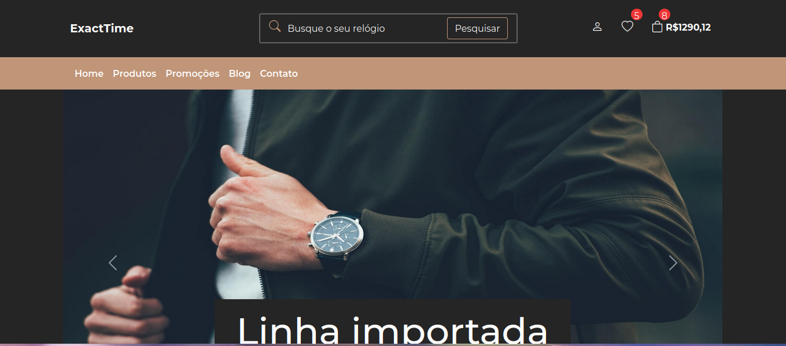
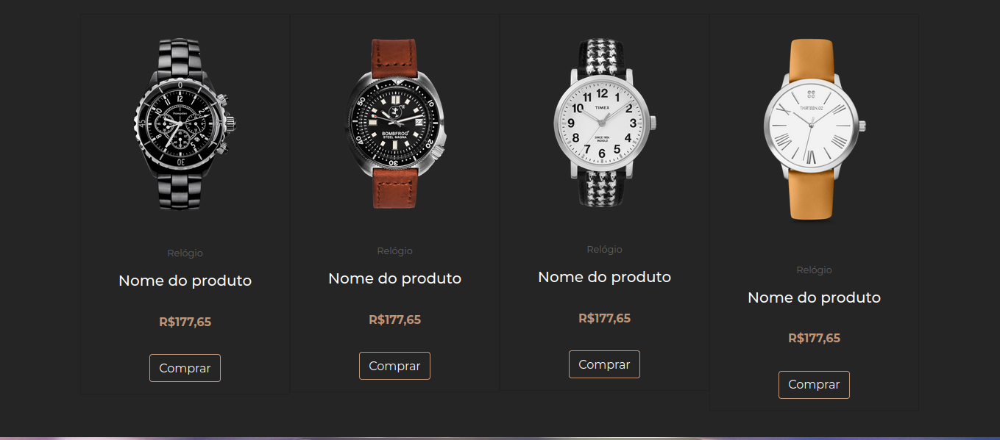
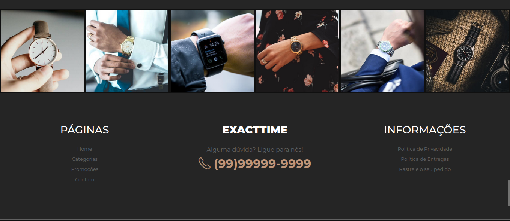

# ExactTime - Luxury Watch Store

ExactTime is a responsive landing page for a luxury watch store, featuring a modern design with a carousel banner, product showcase, and newsletter subscription form.

## Technologies Used

- **HTML5**: Semantic markup availability.
- **CSS3**: Custom styling and layout.
- **Bootstrap 5**: Responsive grid system and components (Navbar, Carousel, Cards).
- **Bootstrap Icons**: Scalable vector icons.
- **Google Fonts**: Montserrat font for typography.

## Project Structure

```bash
.
├── assets/
│   ├── css/
│   │   └── styles.css
│   └── img/
│       ├── banner1.jpg
│       ├── banner2.jpg
│       ├── banner3.jpg
│       ├── banner4.jpg
│       ├── favicon.ico
│       ├── insta1.jpg
│       ├── insta2.jpg
│       ├── insta3.jpg
│       ├── insta4.jpg
│       ├── insta5.jpg
│       ├── insta6.jpg
│       ├── relogio1.png
│       ├── relogio2.png
│       ├── relogio3.png
│       ├── relogio4.png
│       ├── relogio5.png
│       ├── relogio6.png
│       ├── relogio7.png
│       └── relogio8.png
├── index.html
└── README.md
```

## How to Run

1. Clone the repository:
   ```bash
   git clone https://github.com/alexandrerogeriosn93/project-bootstrap-exact-time.git
   ```
2. Open the `index.html` file in your preferred web browser.

## Preview

### Desktop





### Mobile


